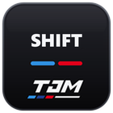

# Shift Lights for iDrive 7

RPM shift lights for BMW iDrive 7 (MGU) on the instrument cluster and the HUD, as an app for the
[mgu-store](https://github.com/robertnisipeanu/mgu-store). OEM-style M slats light up from the outside in,
amber then red, with their own thresholds per drive mode and a lower limit while the engine is cold. The HUD shows the
same M slats as the cluster (0.4.3), and both can dim at night on the car's own day / night signal.
The centre screen holds the settings on six pages (Home, HUD, Cluster, Behavior, About, Check). It draws only when
something changes: there is no live preview, so nothing on that screen competes with the rpm updates.

## Status

Proven on a 2024 X3 M40i (G01 LCI) in a car test: the HUD shift lights and "Only in Sport+" work. On that car 0.4.2's
shift flash turned the bar red but did not flash; 0.4.3 switches the flash from the app instead (see The shift flash).
0.4.3's HUD is unconfirmed on the car: one report (2026-11-07) had the app say "Showing" with nothing on the HUD.
0.4.4 makes "Showing" come from the renderer's own read-back and adds the Check tab (see What Showing means).
0.4.5: on 2026-11-09 the car's HUD sat at "target hud idle, holder none" and Reset HUD drawing changed nothing. The
likely cause is cluster-render's mapping guard (0.4.0 and later), which turns the HUD off after two display drops within
10 s of showing it. The app now reads the guard and the display link from the renderer's status: the verdict says
"Blocked: the renderer turned the HUD off", the self-heal stops rebuilding a target the renderer will not show, and the
whole status text goes to the log (see Check tab: Renderer guard).
Read the Safety section before you install it.

## Requirements

- An iDrive 7 head unit with the mgu-store installed.
- The **cluster-render** tool from `robertnisipeanu/idrive-apps` (Store, Cluster renderer). Install it
  first: the app draws on the cluster and the HUD through it. Without it the app runs, but nothing reaches
  the cluster or the HUD.
- The upstream idrive7-apps source, `cauliflowermossgrape/idrive7-apps` (one of the Store's default sources). The Store installs its GPU renderer and
  controller gate with this app. The controller gate loads into the HMI at the next head-unit start.

## Install

1. In the Store: Settings, **Add source**, type `pinguinooo/idrive7-apps`, OK (the [repo README](../../README.md) has the same steps for every app here).
2. If the repo's page opens, pick **Branch main**. Or type `github.com/pinguinooo/idrive7-apps/tree/main`
   in step 1 to add it on main directly.
3. In the Store: Shift Lights, Install. The head unit builds the app from this source with its own oap-sdk.

Updates follow the `main` branch.

## Settings

Header tabs across the top; turn the knob along the tabs, press to open one, then on down the page (or tap).
Every page fits one screen, the Check tab too. The pill in colour is the value in use; a greyed row says why on its page.

| Page | Setting | Values | Default |
|---|---|---|---|
| Home | HUD | on / off (big card) | off |
| Home | Instrument cluster | on / off (big card) | off |
| Home | When both are on | HUD, Cluster, Both (experimental centre area) | HUD |
| Home | All off | turns both off (the kill switch) | |
| HUD | Style | Large (shift bar + rev bracket), Small (the same with a 70 % shift bar), Bar only, Bracket (rev bracket + gear) | Large |
| HUD | Size | 70 to 120 % | 110 % |
| HUD | Brightness | 20 to 100 % | 100 % |
| HUD | Night dim | Auto (dims while the car says night), On, Off | Auto |
| HUD | Move left / right | 100 px left to 100 px right, steps of 10 | 80 px left |
| HUD | Move up / down | 60 px up to 60 px down, steps of 10 | 60 px down |
| HUD | Shift bar left / right | 100 px left to 100 px right of the HUD, steps of 5 (Large and Bar only) | Same as the HUD |
| HUD | Reset HUD to defaults | size, both moves and the shift bar move back to the defaults (press twice: the first press asks) | |
| Cluster | Style | Large, Small (M slats), Centre row (12 lights), Stock (one block per dial) | Large |
| Cluster | Size, Brightness, Night dim | as on the HUD page | |
| Cluster | Move left / right | 50 px left to 50 px right, steps of 5 | Default |
| Cluster | Move up / down | 40 px up to 40 px down, steps of 5 | Default |
| Behavior | Only in Sport+ | on / off | off |
| Behavior | Start with the car | on / off | on |
| Behavior | Light-up lead | Off, 20 to 150 ms | 60 ms |
| Behavior | Fast RPM | on / off | on |
| Behavior | Drive mode fallback | Comfort, Sport, Sport+ | Sport |
| Behavior | Shift points: first light, per mode | Default, 2,000 to 6,500 rpm | Default |
| Behavior | Shift points: shift (all red), per mode | Default, 2,500 to 6,800 rpm, steps of 100 | Default |
| About | Screen layout | Full screen, Standard | Full screen |
| About | Renderer | GPU, Software | GPU |
| About | Demo data | Auto, Always, Never | Auto |
| About | Shift flash | App (this app switches the flash), Renderer (the cluster plays it) | App |

With the Software renderer, the Standard layout or no touch routing, the screen shows a read-only Home and the
bar's three buttons: HUD on/off, Cluster on/off and Settings, which opens the HMI's own list of every setting
(in the same order as the pages).

A new install starts with both displays off. Settings saved by 0.2.x move over on the first start: a display
that was showing stays on. 0.4.0 keeps every saved setting as it was (and so does 0.4.1: it only adds the Shift bar move, and its start values for fresh installs; and 0.4.2: it changes only what the lights and the Small style show).
0.4.3 moves a few saved values once, on its first start: a HUD size, move or shift bar move that still holds an earlier
default (100 %, Centre, Centre, 70 px right) goes to today's (110 %, 80 px left, 60 px down, Same as the HUD), so an
update gets the tuned place too; any other value you picked stays. A night dim that was on becomes Night dim On, one
that was off becomes Auto. The HUD page's Reset HUD to defaults sets size and moves back at any time.

"Default" uses the built-in thresholds for that mode.

### The shift flash

Since 0.4.2 the whole bar turns red and starts flashing the moment the rpm reaches the drive mode's shift point (the
"Shift (all red)" rpm, or the lower one cold oil sets): on the cluster and the HUD, in every style. In the Bracket style,
which has no shift bar, the bracket's fill turns red and flashes. It stops once the rpm drops 50 rpm under the shift point
(plus the light-up lead while the rpm was climbing), so it does not flicker on a steady rpm. Before 0.4.2 the bar stayed
solid red at the shift point and flashed only in the last 100 rpm under the limiter. The flash rate stays 4 Hz (`flashHz`
in config.js, 4 to 20): the slowest allowed, as the flash now comes at every shift, and its first half is lit, so the bar
shows red at once. Its off half shows nothing at all (not a dimmer red), so the flash is red, dark, red, dark.

Why 0.4.2 did not flash on the car: it handed the flash to the cluster renderer as an animation that switches the
flash's on / off value by itself. The cluster (KOMBI) plays such animations on its own clock; on a G01 it never ran,
so the value stayed at its "on" and the bar stayed solid red. M Track's cover hit the same thing on the same car.
Since 0.4.3 the app switches it instead (About, **Shift flash: App**, the default): while the bar flashes it sends the
on / off value every 125 ms (at most 8 small messages a second a layer, never faster whatever `flashHz` says), every
layer in step, and stops the moment the flash ends; the on value always goes out before the message that starts the
flash, so the first frame is lit. If the link to the renderer is backed up it skips a step rather than queue it.
**Renderer** is 0.4.2's way, for a car whose cluster plays animations.

### HUD styles

Large: the shift bar over the rev bracket and gear. Small (0.4.2): the same layout with the shift bar at 70 % of its size
(`hudStyles.smallBar` in config.js), on the same base line and centred over the bracket; before 0.4.2 Small drew small
shift cells inside the bracket. Bar only: the shift bar alone. Bracket: the rev bracket and gear alone.

Since 0.4.3 the HUD's shift bar is the cluster's Large M slats: 10 slats a side leaning toward the middle, 8 amber then 2
red, a gap in the middle, the same colours, and at the shift point the whole shape red and flashing. It is drawn at 90 %
of the cluster's pixel size (394 x 75 px at 100 %), the largest that stays inside the HUD's visible area at every size
with the default 60 px down. What still differs from the cluster: the glow is 13 px, not 30 (more would spill over the
rev bracket 8 px under it); the unlit slats show dimly at idle (the cluster shows them only once one is lit); the HUD
also has the rev bracket and gear; and on the HUD black is see-through. Before 0.4.3 the HUD bar was BMW's own HUD
design: 15 slats all leaning one way, yellow, orange and a red centre.

### HUD and cluster together

The car shows the cluster panel and the HUD from one scene, so only one of them at a time. With both on,
"When both are on" (Home) picks the one you get: the HUD (default) or the instrument cluster. Home says which
one is showing and that the other is on but not showing. The third choice, HUD plus the
lights in the cluster's centre area, is experimental: on a G01 in the M layout that area showed nothing.

### Drive mode and Only in Sport+

The app reads the car's drive mode (Driving Experience Control). The per-mode thresholds follow it, and "Only
in Sport+" shows the lights only while the car is in Sport+. When the car sends no drive mode, "Drive mode
fallback" is used, and the Behavior page says "the fallback (the car sends none)".

### Start with the car

The app starts with the car (it is installed as an autostart app). With this setting off, it still starts,
but sends nothing to the cluster or the HUD until you open its screen once.

### Cluster position

Since 0.3.1 the cluster bar sits 25 px lower than in 0.3.0 (the M slats' top edge at y 134 of the 1920 x 720
panel, was 109). The Cluster page's Move settings shift it from there in 5 px steps; a move that would put the bar off the
panel falls back to the default place. Keep it clear of the dial numerals either side.

### Night dim

Each display's Night dim is Auto, On or Off. On dims the lit lights to 35 % (`nightDim` in config.js), Off never does.
Auto follows the car's own day / night signal, the one its light sensor sets (`Vehicle` `statusDayNightChangeOver`:
TAG = day, NACHT = night): night dims, day is full brightness. The first value applies at once; after that a change
must hold 5 s before the brightness follows (`nightHoldMs`), so it never flickers. The car sending no signal, or a car
whose software has none, leaves Auto at full brightness (as before 0.4.3, when night dim was a manual switch).
The Night dim row on each page says what it uses now and the car's last value, for example "Auto, car says night
(NACHT): dimmed to 35%", "Auto, no day / night signal from the car yet: full brightness", or "this car sends no day /
night signal". The log has a line for every new value: `car day/night {"dayNightChangeOver":"NACHT"} -> night`.
The signal is the one another iDrive 7 app reads on a G05 (it showed "TAG"); what a G01 sends shows on the Night dim row.

### Lead and Fast RPM

The car sends the engine speed only when it changes, and not very often, so the lights trail the real rpm by up
to one update. Two settings close that gap:

- **Light-up lead** lights each light that much earlier while the rpm climbs (from the slope of the last
  150 ms; nothing when the rpm is steady, falls, or climbs under 1,000 rpm/s). Lights go out a little later by
  the same amount, so they don't flicker. Off gives 0.3.0's behaviour.
- **Fast RPM** asks the car for the rpm (its getter) when no update came for 40 ms: at most 25 times a second,
  one request at a time, backing off to once every 2 s if the car doesn't answer.

### HUD position

The defaults (0.4.1) are the values tuned on the car: 110 %, 80 px left, 60 px down, which lines the art up with the stock
mph. Every step on the HUD page says which value is the default, and Reset HUD to defaults (at the right of the line under
the tabs, while the HUD is on) puts size, both moves and the shift bar move back: the first press turns it into Confirm
reset for 5 s, the second press resets. It is dimmed while everything is at its default. 0.4.3 also moved a saved earlier
default to these once (see above).

The HUD shows a picture of at most 680 x 300 px inside its 800 x 480 scene (wider is cut off). The shift bar has its own
Shift bar left / right move on top of the HUD move, and it is always held inside that box left and right, whatever the
settings (the HUD page says so when it did). 0.4.2's bar was 578 px wide, so the default HUD move put its left end at x 2,
outside the box, and the bar move defaulted to 70 px right. 0.4.3's bar (394 px at 100 %, 434 at 110 %) fits with no move
of its own, centred over the rev bracket: the default is Same as the HUD. The box is assumed centred in the scene
(`hud.visible` in config.js). Up / down is not clamped. The Small style's bar is narrower and stays centred over the
bracket (the Shift bar move is for Large and Bar only).

The gear spot shows 1 to 9 in D, and P, R or N from the selector; a value it does not know shows nothing.

The HUD art is centred on the stock speed. The HUD page's Move settings shift it if it sits off centre on your car; a bigger
size grows upward, away from the speed. The app draws no speed or unit: the stock HUD shows those.

### What Showing means and the Check tab

Up to 0.4.3 the Home card said "Showing" from the settings alone: the display on, chosen and not paused. It never asked
the cluster-render service anything, and it even said "Showing" in demo mode while nothing was sent. Since 0.4.4 the
card, the HUD and Cluster notes and the **Check** tab say what the service read back, first match wins:

| Verdict | What it means |
|---|---|
| Off / On, paused | the setting is off, or Only in Sport+, the kill file or a safety stop holds it (Home says which) |
| Demo data: nothing is sent | the car has not answered, so no layer exists |
| Not sent: no renderer link | no connection to the service yet (or a self-heal is rebuilding the layers) |
| Blocked: the renderer turned the HUD off | cluster-render's mapping guard disabled the target (0.4.5; see Check tab: Renderer guard) |
| Blocked: M Track Cluster holds the scene | another app has layers on the panel or HUD; they share one scene id, so only one shows |
| Sent, the renderer says waiting / parked | the service took the layer but the target waits (scene id in use) or sits behind stock content |
| Sent, not shown yet | the target or a layer is not shown |
| Sent, not confirmed drawn | shown, but the service's status has no "rendered" line for it (not subscribed, or it cannot tell) |
| Showing at 35 %: night dim | rendered, but at under half brightness (Night dim, or the Brightness setting) |
| Showing: the renderer drew it | the target is shown and the service's status says `rendered: renderer ... subscribed for N s` |

"Rendered" is the best proof the app can see that the renderer took our scene. It is not a photo of the HUD: the
cluster-render README lists, as unverified, a scene dropped and published again within a second that was reported
mapped and never drawn, and `panel` and `hud` handing their shared scene id over still do that.

The Check tab shows the proof under the verdict, every time as a clock time (so the page redraws only when the service
says something new): the renderer link, the target's last event, the service's raw `target hud:` status line, the
rendering line in words, our layers and their states, what was last written to each (`u_st`, the bracket image's
opacity and gear) and when, the brightness in use and why, other apps on the shared scene, the renderer guard and the
display link (0.4.5), and the self-heal count.
**Refresh** asks the service for its status now. **Reset HUD drawing** drops our layers, closes the connection, waits
3.5 s and makes them again; after a press it is dimmed for 10 s.

Self-heal (a guess, bounded): the app asks the service's status 5 s after each connect, 0.5 s after any target or layer
event and every 30 s while it shows something. It rebuilds the layers the same way as Reset HUD drawing when a status
newer than our layers still is not shown and rendered 5 s after they were made, when another app just left the shared
scene and ours is not rendered, and on each wake (the 1 s tick sees the wall clock jump over 30 s: the head unit slept,
and the last status is from before that). At most 2 automatic rebuilds per start or wake, never while another app has
layers on the shared scene, and never on "subscription not observable" (a rebuild cannot change that). After 2 the
verdict says it gave up; Reset HUD drawing still works. Whether a rebuild clears the never-drawn state above is not
known; the Check tab is what tells. The timings are `hudCheck` in `config.js`. Since 0.4.5 the second automatic rebuild
waits 60 s after the first (`backoffMs`), none runs while the renderer reports the display link (Dcsm2) down, none at
all (Reset HUD drawing included) while the guard has the target off, and a restart of the service (a guard-reset or a
Store update of Cluster renderer) opens a new window, like a wake.

**Check tab: Renderer guard (0.4.5).** cluster-render 0.4.0 and later strike the HUD's mapping when the display link
(Dcsm2) drops within 10 s of asking for it; two strikes disable the HUD in `/var/opt/cluster-render/state/guard.txt`.
A disabled mapping is never asked for again, however often our layers come and go, so the target stays idle with no
holder and no reason. Restarting the head unit does not clear it. Only a new cluster-render version (Store, Cluster
renderer, Update) or `cluster-render guard-reset` does. The row reads `no strikes`, `1 strike of 2`, or
`HUD off after 2 strikes`; **Display link** gives when Dcsm2 came up (or went down) and the last slot table. The log
gets the guard lines in `cluster-render status:` and the whole status text as `cluster-render status (full):` (on the
first status after each connect and on any guard or link change, 30 a start at most); `tools/car-logs.sh` collects
the renderer's own guard lines. The car-side steps are CAR-DAY-SAFETY 0e in the iDrive-Apps repo.

0.4.2 to 0.4.3, the changes that touch the HUD (`git diff 0e26987 e8ed330 -- apps/adam_shiftlights`):

| Change | Could it blank the HUD? |
|---|---|
| Night dim Auto became the default (`nightDim` 0.35): at night the bracket at 35 %, idle slats at 0.2 x 0.35 | dimmer, not blank; the Check tab shows the brightness in use |
| HUD bar geometry: the cluster's M slats x 0.9 (394 x 75 at 203,69) | no: inside the visible box at every size (tests) |
| `migrateSettings` v4 moves an old default size and move once | no: size and moves only |
| New optional signal `Vehicle.statusDayNightChangeOver` | no: optional, the installer drops it where it is missing |
| Shift flash App (the app sends `u_on`) | no: `u_on` 1 is sent when a layer is made, so an idle bar is never blanked |
| The output path (`geom.layersFor`), the client and the target names | unchanged |

M Track Cluster draws on `panel`, which shares the HUD's scene id. If its Cover is on, the HUD cannot show. Turn the
Cover off in M Track when the Check tab says it holds the scene.

## Screens

From the idrive7-apps emulator (the 1920 x 720 centre screen, scaled down; 0.4.4).

| Home | HUD | Cluster |
|---|---|---|
|  |  |  |
| **Behavior** | **About** | **Check** |
|  |  |  |
| **HUD off** | **Read-only Home** (no touch routing) | |
|  |  | |

## Safety

- Kill switches, fastest first: **All off** on Home (or turn **HUD** and **Instrument cluster** off), a
  file named `DISABLE` in the app's data folder (its path is in the log line `kill switch file:`), or Remove
  in the Store.
- Never kill the app or MainApp by hand. The car counts a hand kill as a crash. Restart it only from the
  Store, and at most once.
- Never reinstall an app that crashed. Remove it with the Store.
- The app stops all cluster and HUD output after 5 errors in 10 seconds. Turn a display off and on to reset
  that. Demo data never reaches the cluster or the HUD.
- The day / night signal is optional: a head unit without it still installs the app (Night dim Auto then stays at full
  brightness). If a Store update ever names `statusDayNightChangeOver` as refused, the old version stays installed.

## Latency

Measured on claudius-vm under Node 8 with `test/adam_shiftlights/latency_trace.js` (the real main.js and kit
car.js against a fake car and a fake cluster-render, 5 pulls at 3000 rpm/s; the getter is the best case):

- The app's own delay from an rpm update to the cluster-render message is about 0.2 ms (p50) in every mode.
- 0.4.0 dropped the preview, and with it all drawing while you drive. With the app screen open (20 updates a
  second, lead 60, Fast RPM on): 0.3.1's 10 fps software preview cost 15 ms a frame (max 57) and held the event
  loop up to 56 ms (p99 30), so an rpm update could wait that long; 0.4.0: 1.8 ms (p99 1.3), the same as with the
  screen closed. On the GPU path 0.3.1 ran its frame callback 838 times in the 13 s run (4 ms at most); 0.4.0
  runs none. Own delay max: 0.8 ms (0.3.1, software) vs 0.3 ms (0.4.0).
- What the driver sees is set by the car's update rate: with no lead, 47 ms (p50) behind the rpm at 10 updates
  a second, 22 ms at 20. Fast RPM with a fresh getter: 19 and 15 ms. Lead 60: about 40 ms early at the socket,
  which leaves room for the cluster's own flush and refresh (not measured here).
- Re-run: `node --expose-gc test/adam_shiftlights/latency_trace.js --hz 20 --lead 60 --poll on --preview software`
  (`--app <older checkout>/apps/adam_shiftlights` for a before run).

## For developers

- Self-check from the repo root (Node 8 is what the car runs): `NODE=/path/to/node8 tools/check.sh`. It syntax-checks every app
  and the kit, checks the cluster-render client against its pinned commit, then runs the unit tests (this app's are in
  `test/adam_shiftlights/`).
- Build like the head unit does: put an `oap-sdk/` (index.js and package.json, made from your own car's
  donor with upstream idrive7-apps' `kit/tools/extract_sdk.js`) at the repo root, then
  `python3 kit/tools/build.py adam_shiftlights`. The package lands in `dist/`. Never commit `oap-sdk/` or a
  built package.
- Icon: `python3 kit/tools/render_icons.py --tile adam_shiftlights` (needs Pillow and headless Chromium)
  renders `kit/icons/adam_shiftlights.svg` to `apps/adam_shiftlights/icon.png`.
- The emulator and shader tests live in the private working repo, not here.
- Don't publish GitHub Releases or tags unless they carry packages. The Store reads this repo as a repo
  tree on its branch.

## Licences

The app's own code is MIT (`LICENSE`). `kit/` is part of
[idrive7-apps](https://github.com/cauliflowermossgrape/idrive7-apps), MIT (`kit/LICENSE`, `kit/NOTICE`), unmodified
but for one line in `kit/tools/build.py` that copies app.json's `"mguAppStartType"` into `package.json`.
`apps/adam_shiftlights/cluster_render_client.js` is from
[idrive-apps](https://github.com/robertnisipeanu/idrive-apps), MPL-2.0 (`apps/adam_shiftlights/NOTICE`).
No BMW code or SDK is in this repo.
